OpenSCAD-Extra
==============

Extra helper modules for [OpenSCAD](https://openscad.org/), mostly for
3D-printed parts.

Each library is a single `.scad` file in [`src/`](src). Open one in OpenSCAD
to see an example of what it makes; the pictures below are those examples.

<table>
  <tr>
    <td align="center"><a href="#countersinkscad">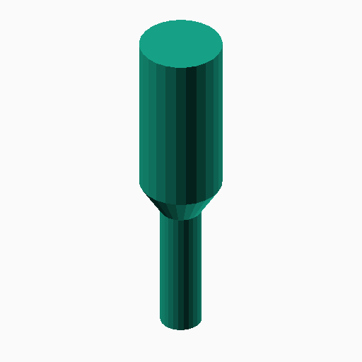<br><code>countersink</code></a></td>
    <td align="center"><a href="#filletscad">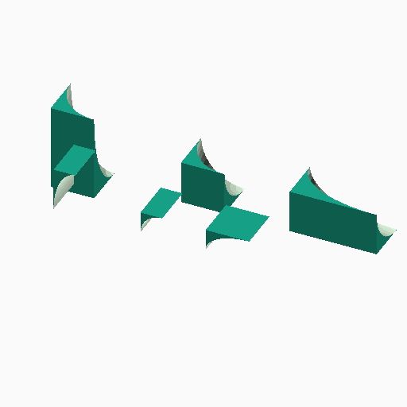<br><code>fillet</code></a></td>
    <td align="center"><a href="#hexagonscad">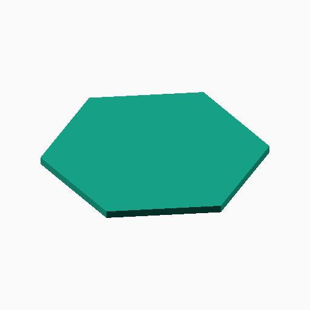<br><code>hexagon</code></a></td>
    <td align="center"><a href="#mtscad">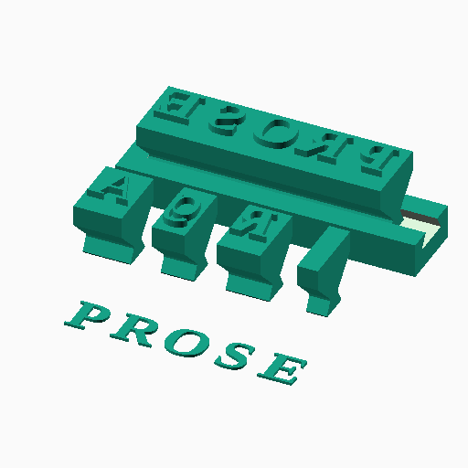<br><code>mt</code></a></td>
  </tr>
  <tr>
    <td align="center"><a href="#nutscad">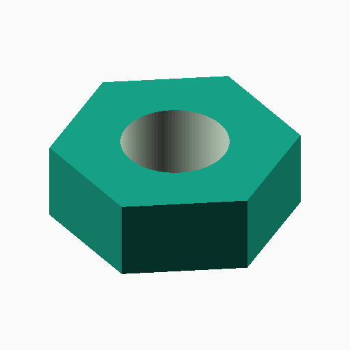<br><code>nut</code></a></td>
    <td align="center"><a href="#roundedscad">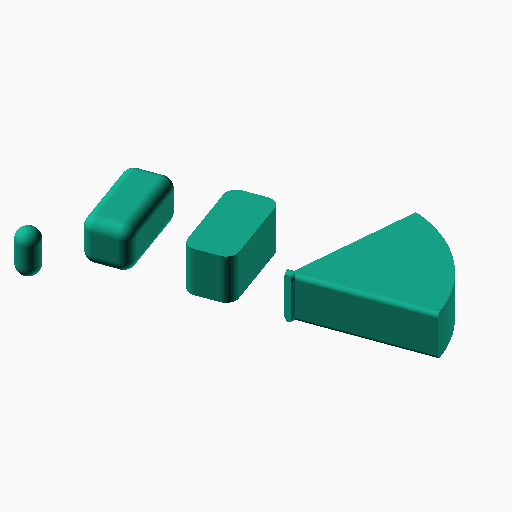<br><code>rounded</code></a></td>
    <td align="center"><a href="#screwscad">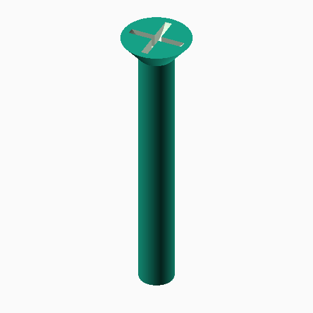<br><code>screw</code></a></td>
    <td align="center"><a href="#springscad">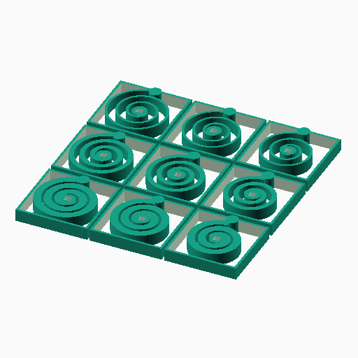<br><code>spring</code></a></td>
  </tr>
  <tr>
    <td align="center"><a href="#strutscad">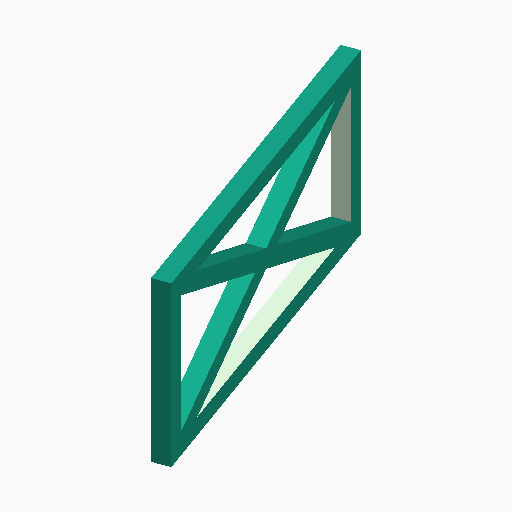<br><code>strut</code></a></td>
    <td align="center"><a href="#torusscad"><br><code>torus</code></a></td>
    <td align="center"><a href="#tubescad">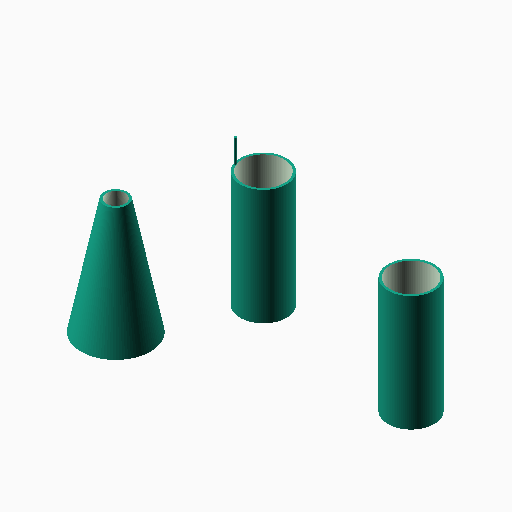<br><code>tube</code></a></td>
    <td align="center"><a href="#wedgescad"><br><code>wedge</code></a></td>
  </tr>
</table>

Using a library
---------------

Put this repo somewhere OpenSCAD can find it, either next to your project or
in your
[OpenSCAD library folder](https://en.wikibooks.org/wiki/OpenSCAD_User_Manual/Libraries),
then load the file you need:

```openscad
use <openscad-extra/src/tube.scad>

tube(d=20, t=2, h=30);
```

`use` loads just the modules. `include` also runs the file's example
geometry, so prefer `use`.

Developed with OpenSCAD 2021.01.

Libraries
---------

### countersink.scad


A cutter for countersunk screw holes: subtract it from a part with
`difference()`. The part's surface goes at z=0. Below it, the cone narrows
from the head diameter to the shaft diameter and the shaft carries on down.
Above it, a head-sized cylinder clears anything over the hole.

```openscad
use <openscad-extra/src/countersink.scad>

difference() {
    translate([-10, -10, -6]) cube([20, 20, 6]);   // top surface at z=0
    make_countersink(d1=3, d2=6, h=2);
}
```

- `make_countersink(d1=2.5, d2=5, h=2, outer=10, inner=10)`: `d1` shaft
  diameter, `d2` head diameter, `h` taper height, `outer` clearance above
  the surface, `inner` hole depth below the surface (including the taper).

### fillet.scad


Fillets for filling inside edges and corners.

- `make_2d_corner_fillet(width=1, depth=1, height=1)`: a straight fillet
  strip, a concave quarter-ellipse profile in XZ extruded `depth` along Y.
  Its legs are `width/2` and `height/2`. Rotate it into the corner it fills.
- `make_3d_corner_fillet(width=1, depth=1, height=1)`: a centered
  `width` x `depth` x `height` block with an ellipsoid scooped out of its
  +X+Y+Z corner, for an inside corner where three faces meet.

### hexagon.scad


A hexagonal prism sized by its width across the flats (the wrench size).
Third-party code with French comments, under the WTFPL.

```openscad
use <openscad-extra/src/hexagon.scad>

Hexagone(cle=25.4, h=1);   // 1 inch across the flats, centered
```

- `Hexagone(cle, h)`: `cle` width across the flats, `h` height.
- `cot(x)`: cotangent.

### mt.scad


Movable type for simple stamps you print at home, for example to tool titles
onto leather book covers and spines. Letters slide onto a dovetail rack, so
one printed set of type can spell any title. The file is standalone: it
doesn't need anything else from this repo.

- `mt_rack(length=100, width=10, floor=3, stop=true)`: the holder, a bar
  with a dovetail groove along it. `stop` closes one end; letters load from
  the other.
- `mt_letter(char, font="Liberation Serif:style=Bold", size=6, width=undef, relief=1)`:
  one piece of type, in any font OpenSCAD can use. Leave out `width` to fit
  the body to the glyph (proportional spacing), or give a fixed width.
- `mt_base(width, depth=10, height=3)`: a letter body with no glyph. It also
  works as a spacer between words.

Everything prints without supports, in the orientation it's modelled in. The
rack prints groove-up. A letter prints tenon-down: the dovetail tenon, a
short neck that clears the rack, a 45° flare out to the body, the body box
(`height`), then the raised glyph on top.

Glyphs are mirrored so the impression reads correctly, which means you set a
line of type right-to-left when looking at its face. In the example, the
word lying in front of the rack is the stamped result.

The fit is set by `buffer` (default 0.5 mm), the gap between each angled side
of the tenon and the groove. `buffer=0` is an exact match, which won't fit
once printed; with 0.5 the squish-out from printing fills the gap and the
letters slide. Tune it for your printer.

```openscad
use <openscad-extra/src/mt.scad>

mt_rack(length=60);

// a set of letters, spaced out on the print bed
for (i = [0 : 4])
    translate([i * 12, 20, 0]) mt_letter("TITLE"[i]);

translate([0, 40, 0]) mt_letter("A", font="Liberation Sans:style=Bold");
```

All defaults are `MT_*` constants at the top of the file.

#### A Baroque italic

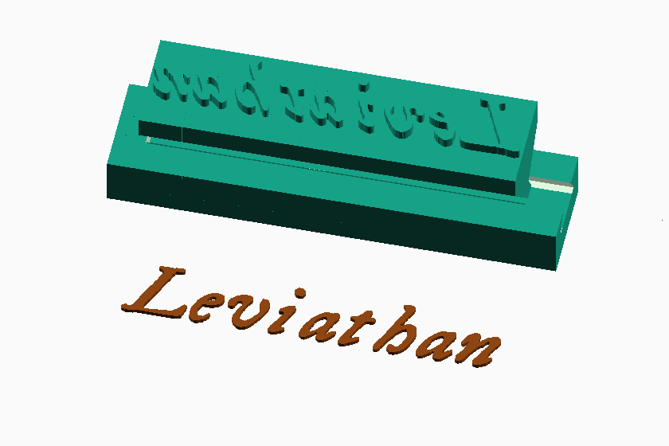

[`examples/mt_baroque.scad`](examples/mt_baroque.scad) sets *Leviathan*
(Hobbes, 1651) in IM FELL DW Pica Italic. IM FELL is a revival of the type
Bishop John Fell collected for the Oxford University Press in the 1670s. Its
italic is semi-cursive: slanted and flowing like handwriting, but each letter
stands on its own, so it works as movable type. The example also shows how to
set a word with proportional letter widths.

The font is free, from
[Google Fonts](https://fonts.google.com/specimen/IM+Fell+DW+Pica), but you
need to install it first. OpenSCAD silently substitutes a default font when
it can't find the one you ask for.

### nut.scad


Hex nuts and nut traps.

- `make_hex_nut(w, h, d=0)`: a centered hex prism, `w` across the flats and
  `h` thick. `d` bores a hole through it; with `d=0` it's a solid nut-trap
  cutout.
- Presets: `make_nut_2(d=2)` (4.8 across, 2 thick), `make_nut_w4_h1p5(d=2)`
  (4 across, 1.5 thick), `make_nut_2_5(d=2, h=3.5)` (5.25 across).
- Test prints with an M2.5 nut trap: `make_nut_2_5_test()`,
  `make_nut_2_5_test_downward()`, `make_nut_2_5_test_punchout()`.

### rounded.scad


Shapes with rounded edges.

- `rounded_cube(size, r=0, center=false)`: a cube with every edge and corner
  rounded to radius `r`.
- `rounded_cube_2d(size, r=0, center=false)`: only the vertical edges are
  rounded; the top and bottom stay flat.
- `pie_slice(r=3, height=1, angle=30)`: a sector of a cylinder, from 0 to
  `angle` degrees (up to 90).
- `rounded_pie(length, height, r, angle=30)`: a pie slice with its two
  straight edges rounded to radius `r`.
- `capsule(d=1, h=1, center=false)`: a cylinder with hemispherical ends,
  `h` long overall. (It used to be called `rounded_cylinder`; for a cylinder
  with rounded edges, see `torus.scad`.)

### screw.scad


A simple unthreaded screw with a countersunk head and a cross slot, centered
along its length. Useful as a placeholder or a clearance cutout.

- `make_screw(length, head_height=1.5, d=2.5)`: `d` shaft diameter; the head
  is `2*d` across.
- Presets: `make_screw_10()`, `make_screw_15()`, `make_screw_20()`.

### spring.scad


Printable flat springs.

- `make_flat_spring(d=5, thickness=1, height=1, width=10, length=50)`: a
  zig-zag spring of half-ring bends (diameter `d`) joined by cross beams.
  Works as a compression, tension or torsion spring.
- `make_contained_flat_spring(..., rim=5)`: the flat spring in a U-shaped
  holder (`make_spring_container()`).
- `make_spiral_spring(r=1, thickness=2, height=1, loops=3)`: a flat spiral
  (clock) spring. The spiral moves out 4 mm per turn, so `thickness` (the
  width of the coil) must be less than 4.
- `make_contained_spiral_spring(r=1, thickness=2, height=5)`: a spiral spring
  in a 30 mm square frame, with an anchor post and a hub with a square hole.
  The example varies `r` and `thickness`.

### strut.scad


A rectangular frame with cross bracing.

- `make_cross_plate(w, h, t, hub_d=0, cross_type=1)`: a centered frame `w`
  wide (Y) and `h` tall (Z), with bars `t` thick (the plate is also `t`
  thick, in X). `cross_type=1` uses straight diagonals and `cross_type=2`
  curved arcs. `hub_d` adds a hub in the middle.
- `make_cross_beams_1(w, h, t)`, `make_cross_beams_2(w, h, t)`: just the
  bracing.

### torus.scad


Tori, torus arcs and rounded-edge cylinders. Needs `wedge.scad` in the same
folder.

- `torus(r1=1, r2=2, angle=360, endstops=0)`: `r1` tube radius, `r2`
  distance from the center to the middle of the tube. With `angle` under 360
  you get an arc centered on +Y; `endstops=1` rounds its ends.
- `rounded_cylinder(d=1, h=1, r=0.1, center=true)`: a cylinder with its top
  and bottom edges rounded to radius `r`, which can be up to half of `d` or
  `h`.

### tube.scad


Hollow cylinders and cones.

- `tube(d, t, h, center=false)`: outer diameter `d`, wall thickness `t`.
- `tube_cone(d1, d2, t, h, center=false)`: a hollow cone or frustum, from
  outer diameter `d1` at the bottom to `d2` at the top.

### wedge.scad


A wedge (sector) of a cylinder, of any angle up to 360°, centered on z and
symmetric about the +Y axis. By Jonathan Hulka, under the GPL v2 or later.

- `wedge(h, r, a)`: height `h`, radius `r`, angle `a` in degrees.

Thumbnails
----------

The images in [`docs/`](docs) come from each library's example.
[`src/create_thumbnails.py`](src/create_thumbnails.py) re-renders any that are
older than their `.scad` file (`--force` re-renders them all):

```sh
cd src
python3 create_thumbnails.py
```

OpenSCAD needs a display to export images. On a headless machine, run it
under `xvfb-run -a`.

`docs/mt_baroque.png` is a screenshot of the preview of
[`examples/mt_baroque.scad`](examples/mt_baroque.scad). A full render of
that example takes a long time, and the preview looks the same:

```sh
cd examples
openscad --projection=ortho --camera=22,-6,3,40,0,12,105 --imgsize=840,560 \
    --colorscheme=Nature -o ../docs/mt_baroque.png mt_baroque.scad
```

License
-------

[MIT](LICENSE), except for two third-party files: `wedge.scad` (GPL v2 or
later, © 2013 Jonathan Hulka) and `hexagon.scad` (WTFPL).
